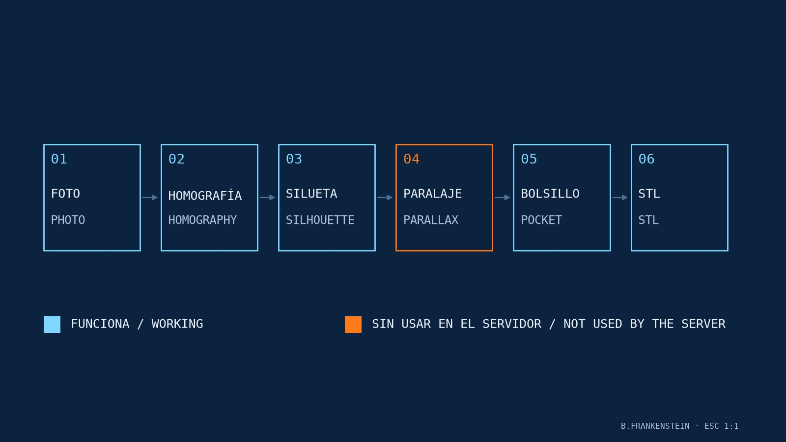
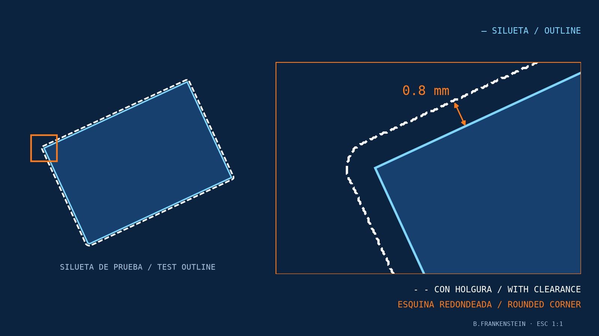
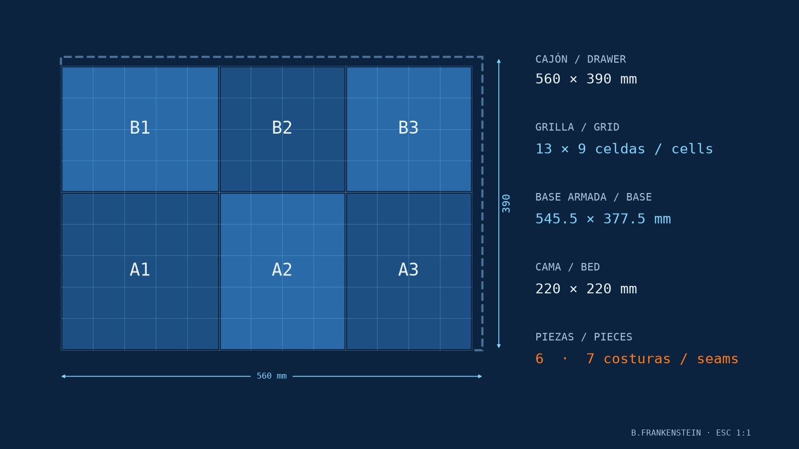
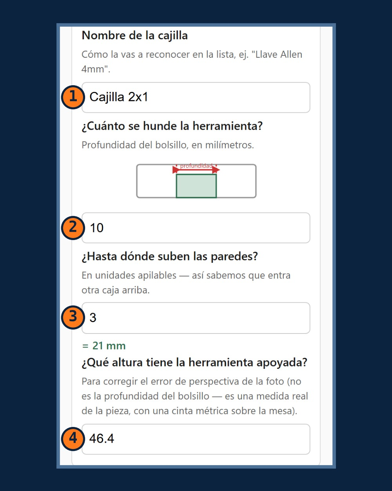
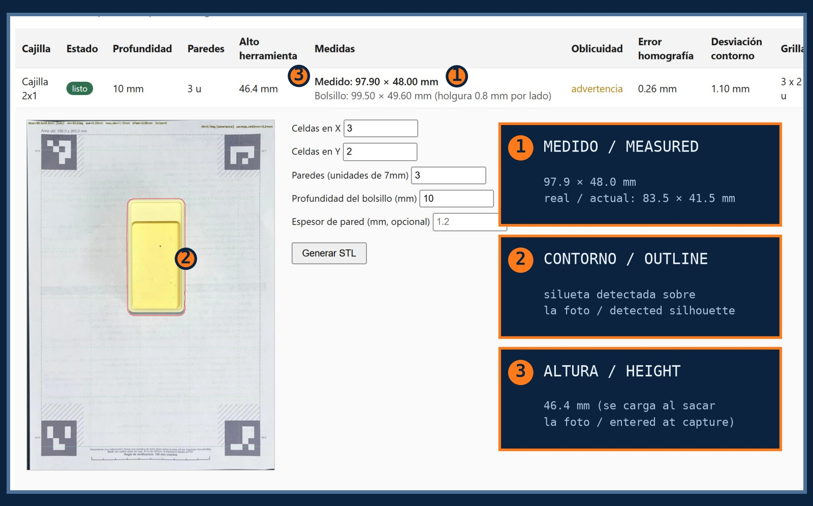
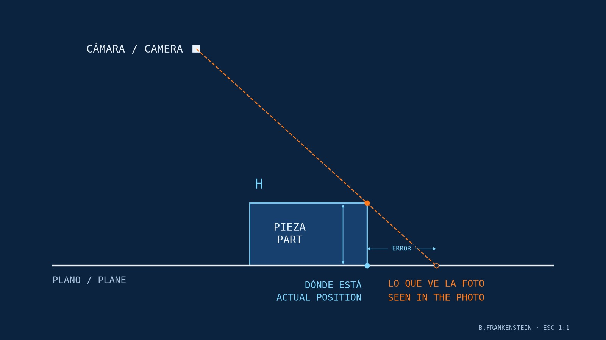
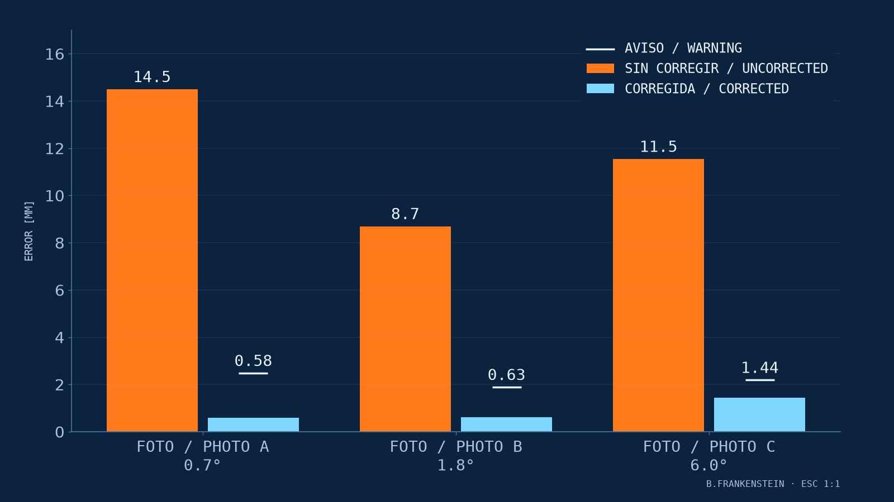
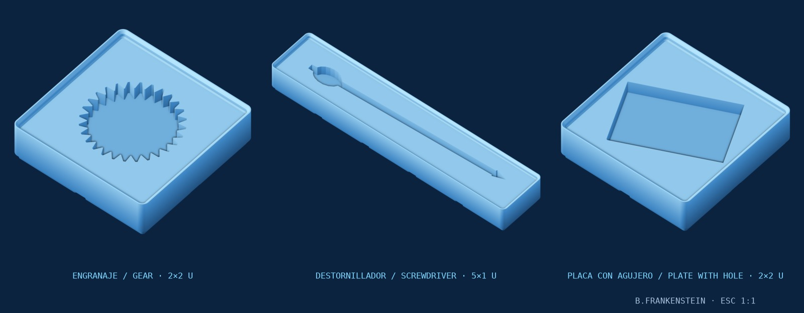

Gridfinity Autobin turns a photo of a tool on a printed A4 sheet into the STL of a Gridfinity bin with a pocket made to measure, and turns a drawer's measurements into a baseplate split into pieces that fit your printer. **It is a work in progress**: the photo-to-STL pipeline runs end to end, but I have not yet tested it with a real printed tool, and several parts of the plan are still missing. Here is what exists, what is missing and what went wrong along the way.

## The problem

Gridfinity is a modular storage system: bins that stack and snap into a 42 mm grid. To store tools, each bin needs a cavity shaped like the tool, and drawing it by hand in CAD takes time. Organising a whole drawer adds another problem: the baseplate has to fill the drawer and, if it is large, be split into pieces that fit the printer bed.

The project tackles both: each tool's holder, from a photo, and the drawer's baseplate, from its measurements.

## How it works

*The photo-to-STL pipeline. Step 04 exists in the vision library, but the server does not use it yet.*

- **An A4 template with four ArUco markers.** They fix the scale and plane of the photo, and a homography maps it to millimetres. The template includes a 100 mm ruler to check it was printed at full size.
- **Everything in millimetres.** No pixel leaves the vision module, and the standard's dimensions live in a single file.
- **Whatever affects accuracy reports its error in millimetres.** "It looks right" does not count as validation.
- **The tool's height is entered when the photo is taken**, so parallax can be corrected (below).
- **Everything runs on the PC, with no account or cloud.** The server shows a QR code; the phone takes the photo over the same Wi-Fi and the PC does the review. It is built with Python, FastAPI, OpenCV and CadQuery.

The test photos on this page show a 2x1 Gridfinity bin, not a tool.

## Making the tool fit: clearance and rounding

A pocket with the exact size from the photo is no good: the tool would not fit, or would only go in by force. So the outline goes through several steps before it becomes a pocket.

- **It is simplified in millimetres.** The photo's outline has thousands of points; it is reduced with a 0.3 mm tolerance, less than the width of a printed line (0.4 mm), and the program reports how far it drifted from the original.
- **Then it is enlarged by 0.8 mm per side.** That is the clearance. It is applied once, and always after simplifying: simplifying an outline that is already enlarged distorts the concave corners.
- **The enlargement is done with a circle.** That is why the corners come out rounded, with a radius equal to the clearance, instead of sharp.
- **The tool's holes are emptied.** The eye of a wrench or the gap in a pair of scissors leave no island of material: the pocket stays open down to the floor.
- **The bin's size is rounded up.** The outline with clearance is covered with whole 42 mm cells, never falling short.
- **Two independent heights.** The pocket depth and the wall height (in stackable units of 7 mm) are chosen separately.
- **For tools with fine detail**, such as gear teeth, the engine can use the convex hull instead of the exact shape. It cannot be chosen from the interface yet.

*The clearance on a (synthetic) test outline. The detail shows the 0.8 mm dimension and the rounded corner.*

This had a bug too: the configured clearance never reached the STL and the pocket came out smaller than the tool. It is fixed and I checked it on the file: with 0.8 mm, the STL's pocket comes out 0.78 and 0.75 mm larger per side.

## From the drawer to the baseplate

You measure the inside of the drawer and the program works out the baseplate.

- **How many cells fit.** It is the largest number of 42 mm cells that fits, rounding down and subtracting a 1.5 mm measuring margin: a real drawer is almost never a perfect rectangle, and a baseplate that does not fit means reprinting.
- **The leftover space.** It goes wherever you choose; by default, to the back of the drawer, the hardest area to reach.
- **If it does not fit the bed, it is split.** Cuts always follow 42 mm grid lines, so the grid is never broken.
- **Pieces are glued butt to butt, with no joints.** There are no pins or dovetails to calibrate: the pieces are glued and real Gridfinity bins resting across the seam while it dries do the aligning. If the bin fits, the seam is right.
- **It comes with an assembly sheet.** A map of the pieces, the seams and the method, generated with each baseplate.

*An example 560 × 390 mm drawer. The assembled baseplate measures 545.5 × 377.5 mm and is split into six pieces for a 220 × 220 mm bed. A to-scale sketch of the pieces.*

The split baseplate exists as STL files and an assembly sheet, but I have not printed or glued it yet. What I did print and check is a 1×1 baseplate and bin, which fit pieces from other generators.

## Several tools and finger holes

Two parts of the plan are still not built.

- **Several tools in one bin.** Today a bin holds one tool. The idea is to put several in a single bin, rotating, mirroring and arranging them. It is the project's biggest scope gap.
- **Finger holes to pull the tool out.** The idea is to place neon-coloured tokens on the template, next to the tool, where you want the hole. The software already detects the tokens and measures their position in millimetres; the radius comes from the token itself. What is missing is generating the hole in the bin.

## The interface

There are two web screens, and both are real: the phone one and the PC one. They are still minimal and in Spanish.

On the phone, the data is entered when the photo is taken: 1) the bin's name, 2) how deep the tool sinks, 3) how high the walls go, in stackable units of 7 mm, and 4) the tool's real height, used to correct parallax.

*The phone capture screen (cropped). It asks for three different heights, each explained as a plain workshop question.*

On the PC, the review screen shows the rectified photo, the detected outline and the form to generate the STL.

*Review on the PC. It shows uncorrected parallax (97.9 × 48.0 mm against the real 83.5 × 41.5 mm) because the server does not yet receive the camera's focal length.*

## An error you cannot see: parallax

For the first weeks everything was validated with synthetic images. On 11 October I took the first real photos: a 46.4 mm tall bin lying on the template. The top edge of a tall part is closer to the camera than its base, so the photo shows it larger, and without correction the silhouette came out up to 14.5 mm too big.

*Why it happens. This is a sketch, not measured data.*

With the declared height, the camera's focal length and the pose recovered from the markers, the program reconstructs where the base is. I calibrated the focal length with a fourth photo of the same bin, standing up, and validated on the three lying ones.

*Largest error in either dimension, against 41.5 × 83.5 mm.*

| Photo | Before | After | Warning |
|---|---|---|---|
| A | 14.5 | 0.58 | 2.48 |
| B | 8.7 | 0.63 | 1.89 |
| C | 11.5 | 1.44 | 2.19 |

*Errors in mm. Camera tilt: A 0.7°, B 1.8°, C 6.0°. Before: uncorrected. After: the corrected silhouette the program delivers. Warning: the largest error the program expects.*

> This is one part and three photos. The reference sizes are the standard's nominal values, not measured with calipers, and the photos arrived recompressed, with no metadata. The expected error is still above my 0.5 mm threshold, so the program flags a "warning" even when the photo is good: I would rather give an honest warning than overpromise.

The cover shows the consequence: the orange outline is what the program detects on the visible edge, and the light-blue one is the part's real footprint, which is hidden underneath.

## What went wrong

- **The stacking lip was upside down.** It passed hundreds of automated tests and showed up when I inspected the part.
- **A lens-distortion correction created the error it claimed to fix.** It was validated with the same data it was fitted on, so it always "improved". Now it is validated with data it did not use for fitting.
- **The review drawing showed the silhouette rotated over an unrotated photo.** The tests did not catch it; it showed up when I looked at the image.
- **Corners bitten inward, a 41.5 mm baseplate socket instead of 42, and clearance that never reached the STL.** I found these in the slicer. I reprinted with the fix and the pieces fit the third-party ones I tried.

The same lesson every time: the most serious defects appeared by looking at the part or the drawing, not by running tests.

## How I build it

The project is a Vibe Code experiment: the code is written by Claude Code agents. One session acts as the manager: it breaks the work down, writes a self-contained brief for each batch and records every decision with its reasoning (up to D-27). Specialist agents then work in their own areas (foundations, vision, CAD, web), each with exclusive ownership of its folder. Closing reports run about 25 lines, and they are checked against the artifact — the STL, the image — not against what the agent says it did.

I decide, take the photos, print and look at what comes out. The last report I reviewed counted 975 automated tests.

## Output examples

*Real STL files from the CAD engine. The silhouettes are synthetic, not photographed tools.*

## Status

| Status | What |
|---|---|
| Done | Photo to silhouette with markers and homography; parallax correction in the library; clearance and rounding; bin with pocket, double height and stacking; split drawer baseplate with assembly sheet; server with QR and STL download |
| In progress | Making the server use the focal length and height to correct parallax |
| Missing | Several tools per bin; generating the finger holes; magnets and embossed label; testing with real tools and with the split baseplate printed; editing the outline by hand; saving projects; Docker install and documentation |

Status as of 12 October 2026, the date of the last change I reviewed. I will update this page as the work moves on.
