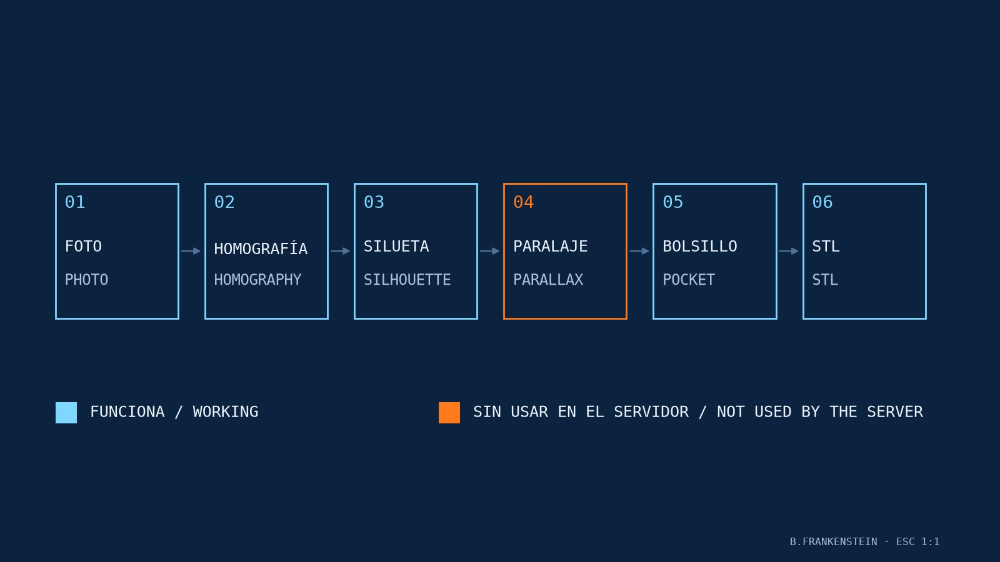
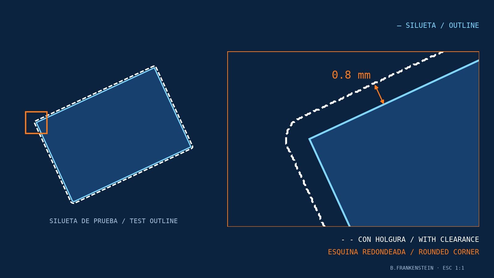
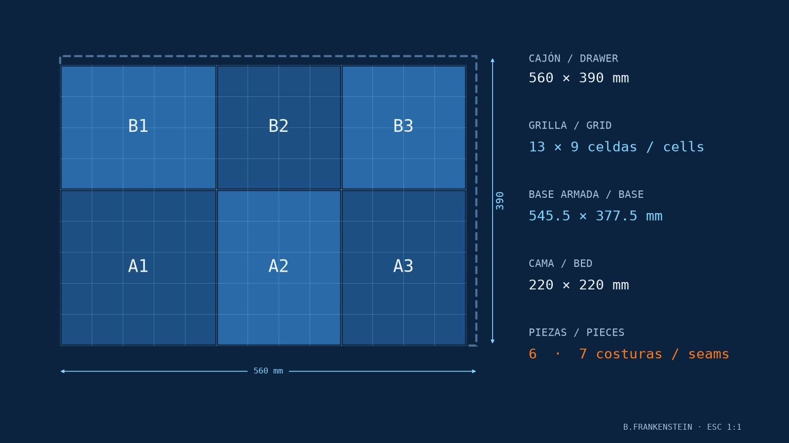
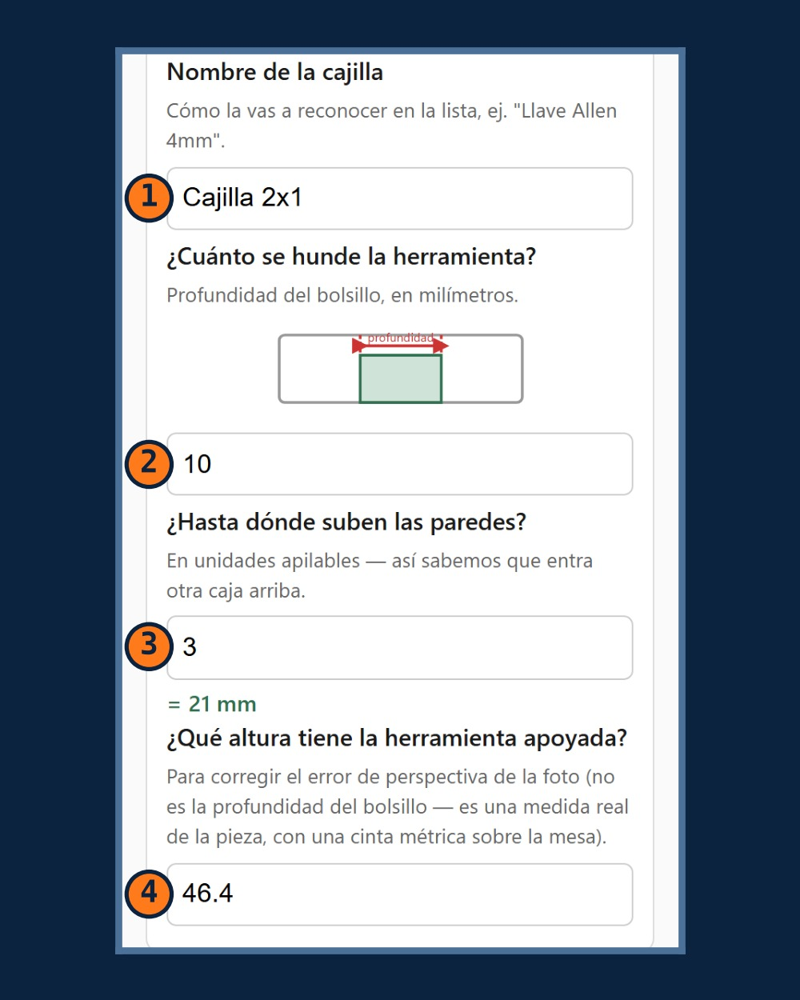
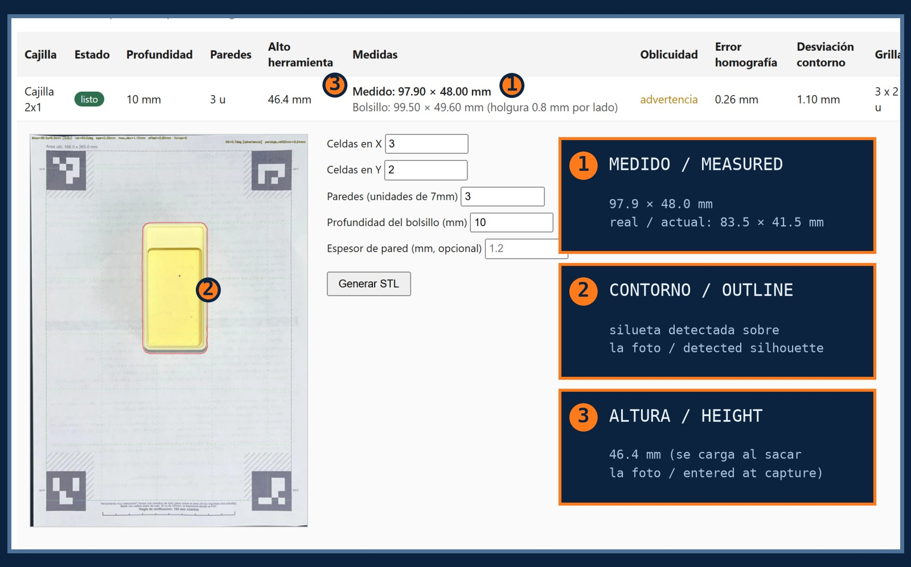
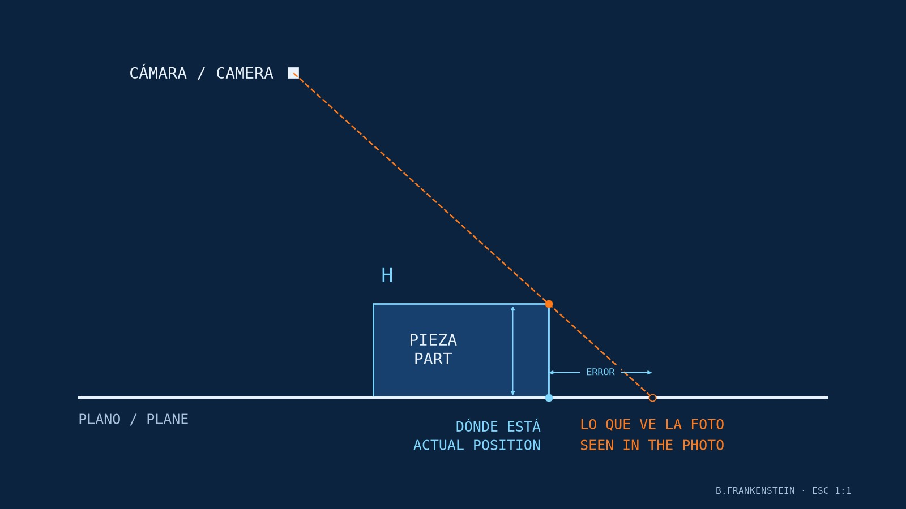
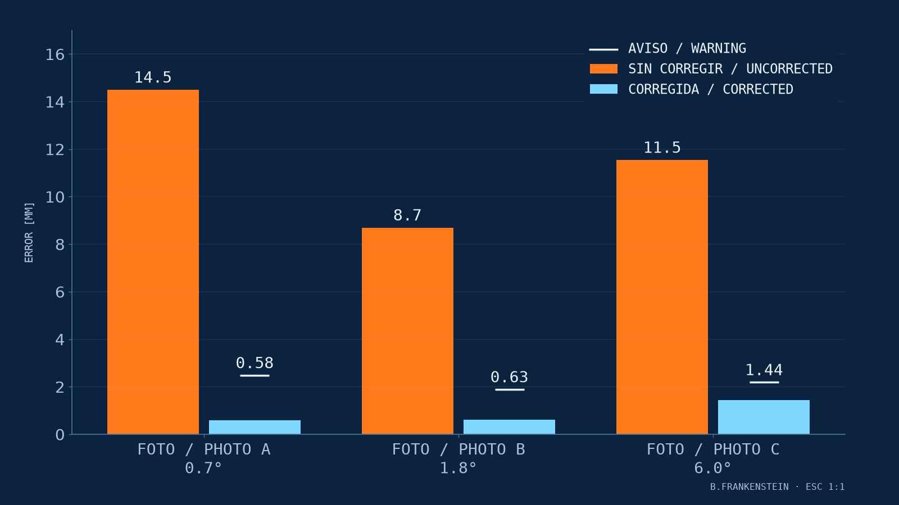
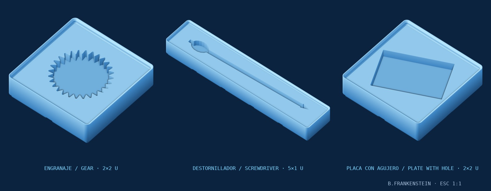

Gridfinity Autobin convierte la foto de una herramienta sobre una hoja A4 impresa en el STL de una cajilla Gridfinity con un hueco a su medida, y las medidas de un cajón en una base de baseplates partida para que entre en tu impresora. **Es un proyecto en curso**: el circuito de la foto al STL funciona de punta a punta, pero todavía no lo probé con una herramienta real impresa y faltan varias piezas del plan. Acá cuento qué hay, qué falta y qué salió mal.

## El problema

Gridfinity es un sistema de almacenamiento modular: cajillas que se apilan y encastran en una grilla de 42 mm. Para guardar herramientas, cada cajilla necesita un hueco con la forma de la herramienta, y dibujarlo a mano en CAD lleva tiempo. Organizar un cajón entero suma otro problema: la base tiene que ocupar el cajón y, si es grande, partirse en piezas que entren en la cama de la impresora.

El proyecto resuelve las dos cosas: el soporte de cada herramienta, a partir de una foto, y la base del cajón, a partir de sus medidas.

## Cómo funciona

*El circuito de la foto al STL. El paso 04 existe en la librería de visión, pero el servidor todavía no lo usa.*

- **Una plantilla A4 con cuatro marcadores ArUco.** Fijan la escala y el plano de la foto, y una homografía la pasa a milímetros. La plantilla trae una regla de 100 mm para comprobar que se imprimió a tamaño real.
- **Todo en milímetros.** Ningún píxel sale del módulo de visión, y las cotas del estándar viven en un único archivo.
- **Lo que afecta la exactitud informa su error en milímetros.** «Se ve bien» no cuenta como validación.
- **La altura de la herramienta se carga al sacar la foto**, para poder corregir el paralaje (más abajo).
- **Todo corre en la PC, sin cuenta ni nube.** El servidor muestra un QR; el teléfono saca la foto por la misma Wi-Fi y la PC supervisa. Está hecho con Python, FastAPI, OpenCV y CadQuery.

Las fotos de prueba de esta lámina son de una cajilla Gridfinity 2x1, no de una herramienta.

## Que la herramienta entre: holgura y redondeo

Un hueco con la medida exacta de la foto no sirve: la herramienta no entraría, o entraría a la fuerza. Por eso el contorno pasa por varios pasos antes de ser un hueco.

- **Se simplifica en milímetros.** El contorno de la foto tiene miles de puntos; se reduce con una tolerancia de 0,3 mm, menos que el ancho de un trazo de impresión (0,4 mm), y el programa informa cuánto se apartó del original.
- **Después se agranda 0,8 mm por lado.** Es la holgura. Se aplica una sola vez y siempre después de simplificar: simplificar un contorno ya agrandado deforma las esquinas cóncavas.
- **El agrandado se hace con un círculo.** Por eso las esquinas salen redondeadas, con radio igual a la holgura, y no en punta.
- **Los agujeros de la herramienta se vacían.** El ojo de una llave o el hueco de unas tijeras no dejan una isla de material: el hueco queda abierto hasta el piso.
- **El tamaño de la cajilla se redondea hacia arriba.** La silueta con holgura se cubre con celdas enteras de 42 mm, sin quedarse corta.
- **Dos alturas independientes.** La profundidad del hueco y la altura de las paredes (en unidades apilables de 7 mm) se eligen por separado.
- **Para herramientas con detalle fino**, como los dientes de un engranaje, el motor puede usar el envolvente convexo en lugar de la forma exacta. Todavía no se elige desde la interfaz.

*La holgura en una silueta de prueba (sintética). El detalle muestra la cota de 0,8 mm y la esquina redondeada.*

Esto también tuvo un error: la holgura configurada no llegaba al STL y el hueco salía más chico que la herramienta. Está corregido y lo verifiqué sobre el archivo: con 0,8 mm, el hueco del STL sale 0,78 y 0,75 mm más grande por lado.

## Del cajón a la base

Se mide el interior del cajón y el programa calcula la base.

- **Cuántas celdas entran.** Es la mayor cantidad de celdas de 42 mm que entra, redondeando hacia abajo y restando un margen de medición de 1,5 mm: un cajón real casi nunca es un rectángulo perfecto, y una base que no entra obliga a reimprimir.
- **El espacio que sobra.** Se manda al lugar que se elija; por defecto, al fondo del cajón, la zona de más difícil acceso.
- **Si no entra en la cama, se parte.** Los cortes van siempre sobre líneas de grilla de 42 mm, para no romper el encastre.
- **Se pega a tope, sin encastres.** No hay pines ni colas de milano que calibrar: se pegan las piezas y la alineación la dan cajillas Gridfinity reales apoyadas a caballo de la costura mientras seca. Si la cajilla entra, la costura quedó bien.
- **Viene con hoja de armado.** Un mapa de las piezas, las costuras y el método, generado con cada base.

*Un cajón de ejemplo de 560 × 390 mm. La base armada mide 545,5 × 377,5 mm y se parte en seis piezas para una cama de 220 × 220 mm. Es un esquema a escala de las piezas.*

La base partida existe como archivos STL y hoja de armado, pero todavía no la imprimí ni la pegué. Lo que sí imprimí y verifiqué es una base y una cajilla de 1×1, que calzan con piezas de otros generadores.

## Varias herramientas y huecos para dedos

Dos partes del plan siguen sin hacerse.

- **Varias herramientas en una misma cajilla.** Hoy una cajilla guarda una herramienta. La idea es poder poner varias en una sola, girándolas, espejándolas y acomodándolas. Es el hueco de alcance más grande del proyecto.
- **Huecos para sacar la herramienta con los dedos.** La idea es apoyar sobre la plantilla fichas de color neón, junto a la herramienta, donde se quiera el hueco. El software ya detecta las fichas y mide su posición en milímetros; el radio sale de la propia ficha. Falta generar el hueco en la cajilla.

## La interfaz

Son dos pantallas web, y las dos son reales: la del teléfono y la de la PC. Todavía son mínimas y están en español.

En el teléfono se cargan los datos al sacar la foto: 1) el nombre de la cajilla, 2) cuánto se hunde la herramienta, 3) hasta dónde suben las paredes, en unidades apilables de 7 mm, y 4) la altura real de la herramienta, que sirve para corregir el paralaje.

*Pantalla de captura del teléfono (recorte). Pide tres alturas distintas, cada una explicada con una pregunta en lenguaje de taller.*

En la PC, la pantalla de supervisión muestra la foto rectificada, el contorno detectado y el formulario para generar el STL.

*Supervisión en la PC. Muestra el paralaje sin corregir (97,9 × 48,0 mm contra 83,5 × 41,5 mm reales) porque el servidor todavía no recibe el foco de la cámara.*

## Un error que no se ve: el paralaje

Durante las primeras semanas todo se validó con imágenes sintéticas. El 11 de octubre saqué las primeras fotos reales: una cajilla de 46,4 mm de alto, acostada sobre la plantilla. El borde de arriba de una pieza alta está más cerca de la cámara que su base, así que la foto lo muestra más grande, y sin corregirlo la silueta salía hasta 14,5 mm de más.

*Por qué pasa. Es un esquema, no un dato medido.*

Con la altura declarada, el foco de la cámara y la pose que sale de los marcadores, el programa reconstruye dónde está la base. El foco lo calibré con una cuarta foto de la misma cajilla, parada, y validé en las tres acostadas.

*Error máximo en las dos medidas, contra 41,5 × 83,5 mm.*

| Foto | Antes | Después | Aviso |
|---|---|---|---|
| A | 14,5 | 0,58 | 2,48 |
| B | 8,7 | 0,63 | 1,89 |
| C | 11,5 | 1,44 | 2,19 |

*Errores en mm. Inclinación de la cámara: A 0,7°, B 1,8°, C 6,0°. Antes: sin corregir. Después: la silueta corregida que entrega el programa. Aviso: el error máximo que el programa estima.*

> Es una sola pieza y tres fotos. Las medidas de referencia son las nominales del estándar, no las medí con calibre, y las fotos llegaron recomprimidas, sin metadatos. El error esperado sigue siendo mayor que mi umbral de 0,5 mm, así que el programa marca «advertencia» aunque la foto esté bien: prefiero un aviso honesto a una promesa de más.

En la portada se ve la consecuencia: el contorno naranja es lo que detecta el programa sobre el borde visible, y el celeste es la huella real de la pieza, que queda tapada.

## Lo que salió mal

- **El labio de apilado estaba al revés.** Pasó cientos de pruebas automáticas y apareció al revisar la pieza.
- **Una corrección de distorsión de lente generaba el error que decía corregir.** La validaba con los mismos datos con que se ajustaba, así que «mejoraba» siempre. Ahora se valida con datos que no usó para ajustarse.
- **El dibujo de supervisión mostraba la silueta rotada sobre la foto sin rotar.** Las pruebas no lo detectaban; apareció al mirar la imagen.
- **Esquinas mordidas hacia adentro, encastre de baseplate de 41,5 mm en lugar de 42 y holgura que no llegaba al STL.** Lo encontré mirando el laminador. Reimprimí con la corrección y las piezas calzan con las de terceros que probé.

La lección repetida: los defectos más serios aparecieron mirando la pieza o el dibujo, no corriendo pruebas.

## Cómo lo construyo

El proyecto es un experimento de Vibe Code: el código lo escriben agentes de Claude Code. Una sesión hace de gestora: desglosa el trabajo, redacta un encargo autocontenido para cada tanda y registra cada decisión con su razón (hasta la D-27). Después trabajan agentes por especialidad (fundaciones, visión, CAD, web), cada uno con propiedad exclusiva de su carpeta. Los reportes de cierre son de unas 25 líneas, y se verifican sobre el artefacto —el STL, la imagen—, no sobre lo que el agente dice haber hecho.

Yo decido, saco las fotos, imprimo y miro lo que sale. El último reporte que revisé contaba 975 pruebas automáticas.

## Ejemplos de salida

*STL reales del motor CAD. Las siluetas son sintéticas, no de herramientas fotografiadas.*

## Estado

| Estado | Qué |
|---|---|
| Hecho | Foto a silueta con marcadores y homografía; corrección de paralaje en la librería; holgura y redondeo; cajilla con hueco, doble altura y apilado; base de cajón partida con hoja de armado; servidor con QR y descarga del STL |
| En curso | Que el servidor use el foco y la altura para corregir el paralaje |
| Falta | Varias herramientas por cajilla; generar los huecos para dedos; imanes y etiqueta en relieve; probar con herramientas reales y con la base partida impresa; editar el contorno a mano; guardar los proyectos; instalación con Docker y documentación |

Estado al 12 de octubre de 2026, fecha del último cambio que revisé. Voy a actualizar esta lámina a medida que avance.
